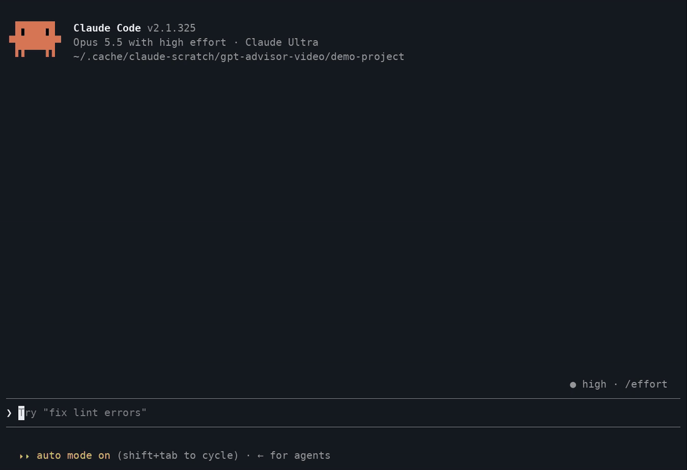

[](demo/gpt-advisor-demo.mp4)

[Watch the demo with sound (MP4)](demo/gpt-advisor-demo.mp4)

# gpt-advisor

A Claude Code plugin. It gives Claude a `gpt_advisor` tool. The tool works like the native advisor tool, but an OpenAI GPT model gives the advice. The plugin calls the model through the Codex CLI.

## What it does

- Claude calls the tool with no parameters.
- The plugin sends the full conversation to GPT: the system prompt, the tool list, the messages, the tool calls and the tool results.
- GPT has no tools. It reads the transcript and returns advice as text.
- The plugin adds guidance to the system prompt. The guidance tells Claude when to call the tool.
- The tool row shows "Advising using <model>", as the native advisor row does. Press ctrl+o to read the advice.
- If the call fails, the tool result tells Claude why. The turn continues.

## Requirements

- Claude Code.
- The Codex CLI (`codex`), installed and logged in.
- The `timeout` command (GNU coreutils). Linux has it.

## Install

At the prompt of a terminal session:

```
/plugin install gpt-advisor --marketplace souf92i/gpt-advisor
```

From a shell:

```
claude plugin install gpt-advisor --marketplace souf92i/gpt-advisor
```

## Settings

Open `/config`. The plugin adds three rows:

| Setting | Values | Default |
|-|-|-|
| GPT advisor | on, off | off |
| Mode | alongside, replace | alongside |
| Model | gpt-6-astra, gpt-6.1-terra, gpt-6.1-sol | gpt-6-astra |

- **GPT advisor**: turns the tool on or off. The change applies from the next turn of the current conversation.
- **Mode**: `alongside` keeps the native advisor too. Claude calls the native advisor first, then GPT. `replace` makes GPT the only advisor. In `replace` mode the plugin warns you if the native advisor is on. Turn the native advisor off with `/advisor`.
- **Model**: the GPT model. The reasoning effort is always `max`.

`/gpt-advisor` shows the settings. `/gpt-advisor model <name>` and `/gpt-advisor mode <mode>` change them.

## Differences from the native advisor

- The tool name is `gpt_advisor`, not `advisor`.
- One call takes minutes, not seconds. The plugin stops a call after 20 minutes.
- The plugin caps the transcript at about 600,000 characters. When the transcript is longer, the plugin removes the oldest messages after the first one and adds a marker.
- The plugin masks secrets before it sends the transcript. It finds them by pattern (API keys, tokens, private keys, JWTs). This is best effort.
- The transcript includes the system prompt and the tool descriptions. Thinking blocks and images are not sent.
- Codex runs read-only, with its shell and other tools turned off.
- While the plugin is installed, Claude Code turns Code Mode off in every session, also when the switch is off. Claude Code does not yet support Code Mode with a plugin that handles tool calls.

## License

MIT
